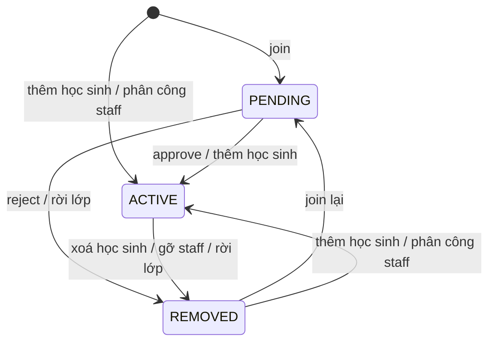

# EduFlow API — Tài liệu tích hợp

Tài liệu này mô tả toàn bộ 29 endpoint đang có của backend EduFlow, dùng làm đầu vào để AI sinh code client (API layer, types, màn hình, xử lý lỗi).

- **Nguồn sự thật:** code trên branch `dev` (gồm cả thay đổi chưa commit) tại ngày 2026-11-01.
- **Kiểm chứng:** status code, body, header, cookie và các quirk ở đây đã được gọi thật trên app chạy với PostgreSQL + Redis. Danh sách endpoint khớp `/v3/api-docs`. Ngoại lệ: [mục 5.5](#55-post-apiauthforgot-password)–[5.7](#57-post-apiauthreset-password) (luồng đặt lại mật khẩu 3 bước) mới được kiểm chứng bằng test với Redis thật và MockMvc, và trên app đang chạy chỉ mới gọi nhánh `resetToken` sai.
- **Không dùng bảng "API gợi ý" ở `docs/README.md` §9:** bảng đó có các route chưa tồn tại như `/api/schedules/me`. Chỉ dùng các endpoint liệt kê trong file này.

## 0. Quy tắc bắt buộc khi sinh code

1. Không tự nghĩ ra endpoint, field, query param hay mã lỗi ngoài tài liệu này. Thiếu API thì xem [mục 10](#10-những-gì-api-chưa-có) và báo lại, không đoán.
2. Mọi request gọi qua cùng origin với client (dev proxy hoặc reverse proxy). Backend **không có CORS**, xem [mục 1.2](#12-cors-và-proxy-bắt-buộc).
3. Client trình duyệt không tự giữ token: `accessToken` và `refreshToken` đều nằm trong cookie HttpOnly, không đọc được bằng JS. Không lưu `accessToken` trong body vào `localStorage`/`sessionStorage` và không gửi header `Authorization`.
4. Gửi `Content-Type: application/json` với mọi request có body. Sai header sẽ nhận 500. Ngoại lệ duy nhất là upload `POST /api/users/import`: gửi `FormData` và không tự đặt `Content-Type`.
5. Trim email phía client trước khi gửi. Email có khoảng trắng đầu/cuối bị trả 400.
6. Refresh phải single-flight, kể cả giữa nhiều tab, xem [mục 3.3](#33-refresh-token-rotation).
7. Rẽ nhánh theo `code` trong body lỗi, không theo `detail` (`detail` lẫn tiếng Anh và tiếng Việt).
8. Chỉ dùng giá trị `sort` trong [mục 2.4](#24-phân-trang). Giá trị khác trả 500, riêng `/api/users` trả 400.
9. Phân biệt 2 mã 401: `AUTHENTICATION_REQUIRED` thì thử refresh, `AUTHENTICATION_FAILED` thì không. Chỉ gọi `/auth/refresh` sau khi một API trả `AUTHENTICATION_REQUIRED`, không gọi chủ động khi tải trang.
10. Response 204 không có body, không gọi `res.json()`.

## 1. Kết nối

### 1.1. Thông tin chung

| Mục | Giá trị |
|---|---|
| Base URL local | `http://localhost:8080` (đổi bằng env `SERVER_PORT`) |
| Prefix | `/api` |
| Định dạng | JSON UTF-8 |
| Xác thực | Cookie `accessToken` (trình duyệt) hoặc `Authorization: Bearer <accessToken>` (Swagger, Postman), và cookie `refreshToken` |
| Swagger UI (public) | `GET /swagger-ui.html` |
| OpenAPI JSON (public) | `GET /v3/api-docs` |

Khởi động backend local:

```bash
docker compose up -d
./mvnw -f migration/pom.xml spring-boot:run
./mvnw spring-boot:run
```

### 1.2. CORS và proxy (bắt buộc)

Backend không cấu hình CORS. Preflight `OPTIONS` từ origin khác nhận **401**, response cũng không có `Access-Control-Allow-Origin`, nên trình duyệt chặn mọi lời gọi trực tiếp từ `http://localhost:5173` sang `http://localhost:8080`.

Cách tích hợp hiện tại là cho client và API cùng origin. Ví dụ với Vite:

```ts
// vite.config.ts
export default defineConfig({
  server: {
    proxy: {
      '/api': { target: 'http://localhost:8080', changeOrigin: true },
    },
  },
});
```

Client gọi đường dẫn tương đối `/api/...`. Production cũng cần cùng site vì cookie là `SameSite=Strict`.

### 1.3. Header

| Header | Chiều | Ý nghĩa |
|---|---|---|
| `Authorization: Bearer <jwt>` | Request | Thay cho cookie `accessToken` khi gọi ngoài trình duyệt. Có cả hai thì header được ưu tiên |
| `Content-Type: application/json` | Request | Bắt buộc khi có body |
| `X-Correlation-ID` | Request (tuỳ chọn) | Regex `[A-Za-z0-9._:-]{1,128}`; sai định dạng thì server tự sinh UUID |
| `X-Correlation-ID` | Response | Luôn có; hiển thị hoặc log kèm lỗi để truy vết |
| `Set-Cookie: refreshToken=...` | Response | Xem [mục 3.1](#31-hai-loại-token) |
| `WWW-Authenticate: Bearer` | Response | Có ở 401 `AUTHENTICATION_REQUIRED` |

## 2. Quy ước dữ liệu

### 2.1. Kiểu dữ liệu

| Kiểu | Định dạng | Ví dụ |
|---|---|---|
| ID | Số nguyên | `12` |
| `Instant` | ISO-8601 UTC, số chữ số thập phân thay đổi | `"2026-10-30T14:50:34Z"`, `"2026-11-29T14:35:34.485175Z"` |
| `LocalDate` | `yyyy-MM-dd` | `"2015-05-20"` |
| Enum | Chuỗi in hoa, phân biệt hoa thường | `"ACTIVE"` |

- Field không có giá trị trả về `null`, **không bị bỏ khỏi JSON**.
- Field lạ trong request bị bỏ qua, không báo lỗi. Ví dụ gửi `"role":"ADMIN"` khi đăng ký vẫn tạo tài khoản `USER`.
- Field text tuỳ chọn gửi chuỗi toàn khoảng trắng được lưu thành `null`. Các field text được server trim.

### 2.2. Enum

```text
UserRole:          ADMIN | SP_ADMIN | TEACHER | ASSISTANT | USER
UserStatus:        ACTIVE | LOCKED | INACTIVE
Gender:            MALE | FEMALE | OTHER
MembershipLevel:   FREE | PLUS | PRO | PREMIUM
ClassStatus:       PENDING | ACTIVE | ARCHIVED
ClassMemberStatus: PENDING | ACTIVE | INACTIVE | REMOVED
```

`ClassStatus.PENDING` là lớp chờ quản trị viên duyệt, `ACTIVE` là lớp đã duyệt và đang hoạt động. `USER` là học sinh. `MembershipLevel` là gói thành viên, không liên quan quyền gọi API. Hiện chưa có API nào đặt member sang `INACTIVE`, nhưng client vẫn phải chấp nhận giá trị này.

### 2.3. Lỗi (RFC 9457 Problem Details)

Mọi lỗi có `Content-Type: application/problem+json` (đôi khi kèm `;charset=UTF-8`, nên kiểm tra bằng `includes('json')`).

```json
{
  "type": "about:blank",
  "title": "Bad Request",
  "status": 400,
  "detail": "One or more request fields are invalid.",
  "instance": "/api/auth/register",
  "code": "VALIDATION_FAILED",
  "correlationId": "14a33686-434f-4990-9bd7-e85f54511474",
  "errors": [
    { "field": "dateOfBirth", "message": "must be a past date" },
    { "field": "password", "message": "must be between 9 and 72 characters" },
    { "field": "guardians[0].fullName", "message": "must not be blank" }
  ]
}
```

- `errors` chỉ có ở `VALIDATION_FAILED`, đã sắp theo `field`. Một field có thể xuất hiện nhiều lần.
- Tên field lồng có dạng `guardians[0].address`.
- `message` là tiếng Anh, chỉ dùng cho log hoặc fallback. Validate phía client để có thông báo tiếng Việt.

Sai kiểu JSON, sai định dạng ngày, sai enum, thiếu body hoặc `classId` không phải số trả `INVALID_REQUEST` và **không có** `errors`.

### 2.4. Phân trang

Áp dụng cho `GET /api/classes`, `GET /api/classes/{classId}/members`, `GET /api/classes/{classId}/join-requests`, `GET /api/users`, `GET /api/users/assignable`.

| Param | Mặc định | Hành vi |
|---|---|---|
| `page` | `0` | Bắt đầu từ 0; số âm coi như 0; vượt trang cuối trả `content: []` |
| `size` | `20` | Tối đa 100, lớn hơn bị **hạ về 100 không báo lỗi**; nhỏ hơn 1 về 20 |
| `sort` | `id,asc` | `field` hoặc `field,asc|desc`; lặp param để sort nhiều cột |

```json
{
  "content": [],
  "page": 0,
  "size": 20,
  "totalElements": 0,
  "totalPages": 0
}
```

Field sort hợp lệ:

| Endpoint | Field |
|---|---|
| `GET /api/classes` | `id`, `name`, `status`, `createdAt`, `updatedAt` |
| `.../members`, `.../join-requests` | `id`, `status`, `joinedAt`, `user.fullName`, `user.email` |
| `GET /api/users`, `GET /api/users/assignable` | `id`, `fullName`, `email`, `createdAt` |

Ở hai endpoint đầu, sort field khác (kể cả `fullName`) trả **500 `INTERNAL_ERROR`**, không phải 400. `/api/users` có whitelist nên trả 400 `INVALID_REQUEST`. Đọc `size` từ response thay vì giả định bằng giá trị đã gửi.

### 2.5. Bảng mã lỗi

| HTTP | `code` | Khi nào | Client xử lý | Gợi ý thông báo |
|---|---|---|---|---|
| 400 | `VALIDATION_FAILED` | Field sai ràng buộc | Gán lỗi vào từng field qua `errors` | Vui lòng kiểm tra lại thông tin |
| 400 | `INVALID_REQUEST` | JSON/ngày/enum/param sai kiểu | Lỗi code client; toast | Yêu cầu không hợp lệ |
| 400 | `GUARDIAN_REQUIRED` | Dưới 18 tuổi, không có người giám hộ (khi đăng ký hoặc khi sửa ngày sinh) | Mở phần nhập người giám hộ; khi sửa hồ sơ thì báo lỗi ở ô ngày sinh | Người dùng dưới 18 tuổi cần ít nhất một người giám hộ |
| 400 | `INVALID_RESET_OTP` | OTP sai, hết hạn, đã dùng hoặc đã nhập sai quá 5 lần | Lỗi ở ô OTP, cho nhập lại hoặc gửi lại mã | Mã OTP không hợp lệ hoặc đã hết hạn |
| 400 | `INVALID_RESET_TOKEN` | `resetToken` sai, hết hạn hoặc đã dùng; tài khoản không còn hoạt động | Quay lại bước nhập email | Phiên đặt lại mật khẩu đã hết hạn, vui lòng yêu cầu mã mới |
| 400 | `INVALID_CURRENT_PASSWORD` | Sai mật khẩu hiện tại khi đổi mật khẩu | Lỗi ở ô mật khẩu hiện tại | Mật khẩu hiện tại không đúng |
| 400 | `INVALID_MEMBER_ROLE` | User không đúng role cho thao tác | Toast | Tài khoản này không thể thực hiện vai trò được chọn |
| 400 | `INVALID_IMPORT_FILE` | File import sai định dạng, thiếu cột bắt buộc, không có dòng dữ liệu, quá 2 MB hoặc quá 500 dòng | Toast, cho chọn file khác | File không hợp lệ. Hãy dùng file mẫu .xlsx, tối đa 2 MB và 500 dòng |
| 401 | `AUTHENTICATION_REQUIRED` | Thiếu, sai, hết hạn access token; tài khoản bị khoá | Refresh rồi gọi lại một lần | (không hiện nếu refresh thành công) |
| 401 | `AUTHENTICATION_FAILED` | Sai đăng nhập; refresh token thiếu, sai, hết hạn, đã dùng | Không refresh. Ở login: báo lỗi; ở refresh: xoá session, về login | Email hoặc mật khẩu không đúng |
| 403 | `ACCESS_DENIED` | Role không được phép | Ẩn nút theo [mục 4](#4-phân-quyền); toast | Bạn không có quyền thực hiện thao tác này |
| 403 | `PASSWORD_CHANGE_REQUIRED` | Tài khoản còn dùng mật khẩu tạm, xem [mục 3.5](#35-mật-khẩu-tạm) | Cập nhật `mustChangePassword` và hiện form đổi mật khẩu | Vui lòng đổi mật khẩu tạm trước khi tiếp tục |
| 404 | `CLASSROOM_NOT_FOUND` | Lớp không tồn tại, **hoặc** caller không có membership `ACTIVE`, hoặc mã tham gia sai | Trang "không tìm thấy" | Không tìm thấy lớp học |
| 404 | `RESOURCE_NOT_FOUND` | Route sai, user hoặc membership không tồn tại | Toast hoặc trạng thái rỗng | Không tìm thấy dữ liệu |
| 405 | `METHOD_NOT_ALLOWED` | Sai HTTP method | Lỗi code client | Yêu cầu không hợp lệ |
| 409 | `EMAIL_ALREADY_REGISTERED` | Email đã tồn tại (không phân biệt hoa thường) | Lỗi ở ô email | Email đã được đăng ký |
| 409 | `CLASSROOM_NAME_ALREADY_USED` | Tên lớp trùng toàn hệ thống (không phân biệt hoa thường, gồm cả lớp đã lưu trữ) | Lỗi ở ô tên | Tên lớp đã tồn tại |
| 409 | `CLASSROOM_ARCHIVED` | Ghi vào lớp đã lưu trữ | Làm mới lớp, khoá thao tác | Lớp đã được lưu trữ |
| 409 | `CLASSROOM_NOT_ARCHIVED` | Khôi phục lớp chưa lưu trữ | Làm mới dữ liệu | Lớp chưa được lưu trữ |
| 409 | `CLASSROOM_PENDING_APPROVAL` | Ghi vào hoặc tham gia lớp đang chờ duyệt | Làm mới lớp, khoá thao tác | Lớp đang chờ duyệt |
| 409 | `CLASSROOM_NOT_PENDING` | Duyệt lớp không ở trạng thái `PENDING` | Làm mới dữ liệu | Lớp không còn ở trạng thái chờ duyệt |
| 409 | `MEMBERSHIP_CONFLICT` | Trạng thái membership không cho phép | Làm mới danh sách | Trạng thái thành viên đã thay đổi |
| 409 | `CANNOT_MODIFY_SELF` | Tự khoá, mở khoá, đổi role hoặc đặt lại mật khẩu hộ cho chính mình | Ẩn thao tác; toast | Không thể thực hiện thao tác này với chính tài khoản của bạn |
| 409 | `USER_HAS_ACTIVE_MEMBERSHIP` | Đổi role khi user còn membership `PENDING` hoặc `ACTIVE`, trừ đổi giữa `TEACHER` và `ASSISTANT` | Toast, hướng dẫn gỡ khỏi lớp trước | Người này vẫn còn trong lớp. Hãy gỡ khỏi lớp trước khi đổi vai trò |
| 500 | `INTERNAL_ERROR` | Lỗi không lường trước | Toast kèm `correlationId` | Đã có lỗi xảy ra |
| 503 | `PASSWORD_CHANGE_UNAVAILABLE` | Redis/DB lỗi khi đặt lại mật khẩu | Yêu cầu OTP mới sau | Dịch vụ tạm gián đoạn, vui lòng yêu cầu mã mới |

Không có 429: `/forgot-password` và `/verify-otp` có giới hạn nhưng cố ý không trả 429 để không tiết lộ email nào có tài khoản ([mục 5.5](#55-post-apiauthforgot-password), [mục 5.6](#56-post-apiauthverify-otp)). Các API khác chưa giới hạn tần suất.

## 3. Xác thực và phiên đăng nhập

### 3.1. Hai loại token

| | Access token | Refresh token |
|---|---|---|
| Dạng | JWT HS256, payload `sub`, `iat`, `exp`, `role` | Chuỗi ngẫu nhiên, chỉ lưu hash trong DB |
| Nơi lưu | Cookie HttpOnly | Cookie HttpOnly |
| Thời hạn mặc định | 15 phút | 30 ngày |
| Thu hồi | Không thu hồi được, sống đến khi hết hạn; riêng user không còn `ACTIVE` bị từ chối ngay | Thu hồi khi dùng, logout, đặt lại hoặc đổi mật khẩu |

Thuộc tính cookie:

```text
Set-Cookie: refreshToken=<opaque>; Path=/api/auth; Max-Age=2592000; HttpOnly; SameSite=Strict
Set-Cookie: accessToken=<jwt>; Path=/api; Max-Age=900; HttpOnly; SameSite=Strict
```

- `refreshToken` chỉ gửi kèm các request tới `/api/auth/*`, `accessToken` gửi kèm mọi request tới `/api/*`. Cả hai có thêm `Secure` khi backend nhận request qua HTTPS.
- Backend tắt CSRF token, nên `SameSite=Strict` là lớp chống CSRF cho xác thực bằng cookie. Không nới lỏng thuộc tính này và không bật CORS có credentials.
- `AuthResponse` vẫn trả `accessToken` trong body cho client ngoài trình duyệt (Swagger, Postman). Client web bỏ qua field này.
- Cùng origin: `fetch` mặc định gửi cookie, nên dùng `credentials: 'same-origin'`.
- TTL cấu hình bằng env, nên dùng `accessExpiresAt` và `refreshExpiresAt` thay vì hard-code.
- Lấy thông tin user từ field `user` trong response, không decode JWT.
- Server restart sẽ sinh khoá ký mới, mọi access token cũ thành 401 `AUTHENTICATION_REQUIRED`. Luồng refresh tự xử lý, refresh token vẫn dùng được.

### 3.2. Khôi phục phiên khi tải lại trang

Khi khởi động app, gọi `GET /api/auth/me` qua luồng API thông thường, đúng một lần:

1. 200: cookie còn hạn, lưu `user` vào state. Không gọi `/auth/refresh`.
2. 401 `AUTHENTICATION_REQUIRED`: cookie đã hết hạn, chạy luồng refresh ở [mục 3.3](#33-refresh-token-rotation) rồi gọi lại `/me`.
3. Refresh trả 401 `AUTHENTICATION_FAILED`: người dùng chưa đăng nhập, về màn hình login. Đây là trạng thái bình thường, không hiện lỗi.

Vì vậy khách chưa đăng nhập luôn có một cặp 401 (`/me`, `/auth/refresh`) trong network khi tải trang.

### 3.3. Refresh token rotation

Mỗi lần refresh, token cũ bị vô hiệu và cookie được thay mới. Dùng lại token cũ trả 401 `AUTHENTICATION_FAILED`. Vì vậy:

- Hai request refresh đồng thời với cùng cookie: một cái thành công, cái kia **đá người dùng ra ngoài** nếu client xử lý 401 theo cách thông thường.
- Trong một tab: dùng chung một Promise refresh.
- Giữa nhiều tab: dùng Web Locks (`navigator.locks`). Tab chờ lock sẽ gửi cookie mới nhất nên không bị lỗi.

Luồng khi gọi API:

```text
request → 401 AUTHENTICATION_REQUIRED
        → refresh (single-flight)
            ├─ 200 → lưu token mới → gửi lại request ĐÚNG 1 LẦN
            └─ 401 AUTHENTICATION_FAILED → xoá session → về login
```

Không refresh chủ động: chỉ refresh sau khi API trả `AUTHENTICATION_REQUIRED`.

### 3.4. Đăng xuất, đặt lại và đổi mật khẩu

- Logout chỉ thu hồi refresh token của phiên hiện tại và xoá cả 2 cookie. Client phải tự xoá state và cache trong bộ nhớ.
- Đặt lại và đổi mật khẩu đều thu hồi **mọi** refresh token của user và xoá cả 2 cookie ở trình duyệt gọi API. Access token trên thiết bị khác vẫn dùng được đến khi hết hạn.

### 3.5. Mật khẩu tạm

Tài khoản do admin tạo, hoặc được admin đặt lại mật khẩu hộ, có `mustChangePassword: true` trong `UserSummary`.

- Backend chặn ngay ở filter xác thực. Khi cờ bật, access token chỉ gọi được `GET /api/auth/me` và `POST /api/auth/change-password`. Mọi route cần đăng nhập khác trả 403 `PASSWORD_CHANGE_REQUIRED`. Route công khai như `logout` không bị ảnh hưởng.
- `newPassword` trùng mật khẩu tạm trả 400 `VALIDATION_FAILED` với `errors[0].field = "newPassword"`.
- Đổi mật khẩu hoặc đặt lại qua "Quên mật khẩu" đều xoá cờ.
- Admin có thể đặt lại mật khẩu khi người dùng đang đăng nhập, nên client phải xử lý `PASSWORD_CHANGE_REQUIRED` ở mọi API, không chỉ sau login. Người dùng có thể chưa được báo là mật khẩu đã đổi, vì vậy form phải có nút đăng xuất.

## 4. Phân quyền

Có 2 lớp kiểm tra, cho 2 kết quả khác nhau:

1. **Role hệ thống** không đạt → 403 `ACCESS_DENIED`.
2. **Phạm vi lớp**: `TEACHER`, `ASSISTANT`, `USER` phải có membership `ACTIVE` trong lớp, không thì 404 `CLASSROOM_NOT_FOUND` (cố ý, để không dò được ID lớp). `ADMIN`, `SP_ADMIN` truy cập mọi lớp mà không cần membership.

Role áp dụng như nhau ở mọi lớp, không có role riêng theo lớp.

| Endpoint | ADMIN / SP_ADMIN | TEACHER | ASSISTANT | USER |
|---|---|---|---|---|
| `POST /api/classes` | ✅ | ✅ | ❌ | ❌ |
| `GET /api/classes` | ✅ mọi lớp | ✅ lớp của mình | ✅ lớp của mình | ✅ lớp của mình |
| `GET /api/classes/{id}` | ✅ | ✅ thành viên | ✅ thành viên | ✅ thành viên |
| `PATCH /api/classes/{id}` | ✅ | ✅ thành viên | ❌ | ❌ |
| `DELETE /api/classes/{id}` | ✅ | ✅ thành viên | ❌ | ❌ |
| `POST .../approve` | ✅ | ❌ | ❌ | ❌ |
| `POST .../restore` | ✅ | ❌ | ❌ | ❌ |
| `POST .../join-code/rotate` | ✅ | ✅ thành viên | ❌ | ❌ |
| `POST /api/classes/join` | ❌ | ❌ | ❌ | ✅ |
| `PUT/DELETE .../staff/{userId}` | ✅ TEACHER, ASSISTANT | ✅ chỉ ASSISTANT | ❌ | ❌ |
| `GET .../members` | ✅ | ✅ thành viên | ✅ thành viên | ✅ thành viên, chỉ `ACTIVE`, không có email |
| `POST .../students`, `DELETE .../students/{userId}` | ✅ | ✅ thành viên | ✅ thành viên | ❌ |
| `GET .../join-requests`, `POST .../approve`, `POST .../reject` | ✅ | ✅ thành viên | ✅ thành viên | ❌ |
| `GET .../membership/me` | ✅ (thường 404) | ✅ | ✅ | ✅ |
| `DELETE .../membership/me` | ❌ | ❌ | ❌ | ✅ |
| `GET /api/users`, `GET /api/users/{id}` | ✅ | ❌ | ❌ | ❌ |
| `GET /api/users/assignable` | ✅ TEACHER, ASSISTANT | ✅ chỉ ASSISTANT | ❌ | ❌ |
| `POST /api/users`, `POST /api/users/import` | ✅ (xem dưới) | ❌ | ❌ | ❌ |
| `POST /api/users/{id}/lock`, `/unlock`, `/reset-password` | ✅ (xem dưới) | ❌ | ❌ | ❌ |
| `PATCH /api/users/{id}/role` | Chỉ `SP_ADMIN` | ❌ | ❌ | ❌ |

Trong nhóm `/api/users`, `ADMIN` và `SP_ADMIN` khác nhau:

| Thao tác | `ADMIN` với HS/GV/TG | `ADMIN` với admin | `SP_ADMIN` với người khác | Với chính mình |
|---|---|---|---|---|
| Tạo tài khoản | Được | 403 | Được | Không áp dụng |
| Khoá, mở khoá, đặt lại mật khẩu | Được | 403 | Được | 409 |
| Đổi role | 403 | 403 | Được | 409 |

`joinCode` chỉ có giá trị khi caller là `ADMIN`, `SP_ADMIN`, `TEACHER`; với `ASSISTANT` và `USER` là `null`.

Lớp `ARCHIVED` chỉ đọc: mọi thao tác ghi trả 409 `CLASSROOM_ARCHIVED`, kể cả rời lớp và tham gia lớp. Chỉ `restore` được phép.

Lớp `PENDING` cũng bị khoá: sửa lớp, xoay mã, quản lý thành viên và tham gia lớp đều trả 409 `CLASSROOM_PENDING_APPROVAL`. Chỉ `approve` và `DELETE` (lưu trữ, tức huỷ hoặc từ chối yêu cầu) được phép.

## 5. Auth API

Các endpoint nhóm này là public, không cần access token. Ngoại lệ cần đăng nhập, mọi role đều gọi được: [mục 5.8](#58-post-apiauthchange-password), [5.9](#59-get-apiauthme), [5.10](#510-put-apiauthme).

### 5.1. `POST /api/auth/register`

Tạo tài khoản role `USER`, trạng thái `ACTIVE`, gói `FREE`, và đăng nhập luôn.

| Field | Kiểu | Bắt buộc | Ràng buộc |
|---|---|---|---|
| `email` | string | ✅ | Email hợp lệ, tối đa 320 ký tự, không có khoảng trắng đầu/cuối; server chuyển thành chữ thường |
| `password` | string | ✅ | 9–72 ký tự, có chữ hoa và ký tự đặc biệt, chỉ ASCII in được |
| `fullName` | string | ✅ | Không rỗng, tối đa 150 |
| `phone` | string | | Tối đa 32 |
| `dateOfBirth` | `yyyy-MM-dd` | ✅ | Ngày trong quá khứ |
| `gender` | Gender | | |
| `address` | string | | |
| `school` | string | | Tối đa 200 |
| `grade` | string | | Tối đa 50 |
| `guardians` | array | Khi dưới 18 tuổi | Tối đa 5 phần tử |
| `guardians[].fullName` | string | ✅ | Không rỗng, tối đa 150 |
| `guardians[].phone` | string | ✅ | Không rỗng, tối đa 32 |
| `guardians[].address` | string | ✅ | Không rỗng |
| `guardians[].relationship` | string | | Tối đa 50 |

Regex mật khẩu: `^(?=.*[A-Z])(?=.*[^A-Za-z0-9\s])[\x20-\x7E]+$`. Không bắt buộc có chữ số. Ký tự đặc biệt là ký tự không phải chữ, số, khoảng trắng.

Điều kiện dưới 18 tuổi: `dateOfBirth + 18 năm` sau ngày hiện tại (theo UTC). Client nên hiện phần người giám hộ ngay khi nhập ngày sinh.

```json
{
  "email": "kid@example.com",
  "password": "Password1!",
  "fullName": "Nguyễn Văn A",
  "phone": "0900000000",
  "dateOfBirth": "2015-05-20",
  "gender": "FEMALE",
  "address": "Hà Nội",
  "school": "THCS A",
  "grade": "6",
  "guardians": [
    { "fullName": "Trần Thị B", "phone": "0911111111", "address": "Hà Nội", "relationship": "MOTHER" }
  ]
}
```

**201** + `Set-Cookie` + `AuthResponse`:

```json
{
  "accessToken": "eyJhbGciOiJIUzI1NiJ9...",
  "tokenType": "Bearer",
  "accessExpiresAt": "2026-10-30T14:50:34Z",
  "refreshExpiresAt": "2026-11-29T14:35:34.485175Z",
  "user": {
    "id": 1,
    "email": "kid@example.com",
    "fullName": "Nguyễn Văn A",
    "phone": "0900000000",
    "dateOfBirth": "2015-05-20",
    "gender": "FEMALE",
    "address": "Hà Nội",
    "school": "THCS A",
    "grade": "6",
    "role": "USER",
    "membershipLevel": "FREE",
    "mustChangePassword": false
  }
}
```

Lỗi: 400 `VALIDATION_FAILED`, `INVALID_REQUEST`, `GUARDIAN_REQUIRED`; 409 `EMAIL_ALREADY_REGISTERED`.

### 5.2. `POST /api/auth/login`

| Field | Kiểu | Bắt buộc | Ràng buộc |
|---|---|---|---|
| `email` | string | ✅ | Email hợp lệ, tối đa 320, không có khoảng trắng đầu/cuối |
| `password` | string | ✅ | Tối đa 72 ký tự, chỉ ASCII in được |
| `deviceName` | string | | Tối đa 255 |

```json
{ "email": "student@example.com", "password": "Password1!", "deviceName": "Chrome on macOS" }
```

**200** + `Set-Cookie` + `AuthResponse`.

Lỗi: 400 `VALIDATION_FAILED`; 401 `AUTHENTICATION_FAILED`. Sai email, sai mật khẩu, tài khoản `LOCKED` hoặc `INACTIVE` đều cùng một lỗi, không phân biệt được.

### 5.3. `POST /api/auth/refresh`

Không có body. Dùng cookie `refreshToken`.

**200** + `Set-Cookie` mới + `AuthResponse`.

Lỗi: 401 `AUTHENTICATION_FAILED` khi cookie thiếu, sai, hết hạn, đã dùng, hoặc user không còn `ACTIVE`.

### 5.4. `POST /api/auth/logout`

Không có body. Dùng cookie `refreshToken`, không cần access token.

**204**, không body, luôn xoá cookie. Không có cookie vẫn 204. Không lỗi nghiệp vụ.

### 5.5. `POST /api/auth/forgot-password`

Bước 1/3 của luồng đặt lại mật khẩu.

| Field | Kiểu | Bắt buộc | Ràng buộc |
|---|---|---|---|
| `email` | string | ✅ | Email hợp lệ, tối đa 320 |

```json
{ "email": "student@example.com" }
```

**200**, kể cả khi email không tồn tại hoặc yêu cầu bị giới hạn:

```json
{ "message": "Nếu tài khoản hợp lệ, yêu cầu gửi OTP đã được tiếp nhận." }
```

- OTP gồm 6 chữ số, gửi qua email, hiệu lực 10 phút.
- Gửi email bất đồng bộ, 200 không đảm bảo mail đã gửi được.
- Yêu cầu mới thay thế OTP cũ và mở lại số lần nhập.
- Mỗi email chỉ được gửi 1 mã trong 60 giây và tối đa 5 mã trong 1 giờ. Vượt giới hạn thì **không có mail nào được gửi** nhưng vẫn trả 200, vì vậy nút "gửi lại mã" phải có countdown 60 giây.
- Luôn chuyển sang màn hình nhập OTP, không tiết lộ email có tồn tại hay không.

Lỗi: 400 `VALIDATION_FAILED`; 503 `PASSWORD_CHANGE_UNAVAILABLE`.

### 5.6. `POST /api/auth/verify-otp`

Bước 2/3: đổi OTP lấy `resetToken` dùng một lần.

| Field | Kiểu | Bắt buộc | Ràng buộc |
|---|---|---|---|
| `email` | string | ✅ | Email hợp lệ, tối đa 320 |
| `otp` | string | ✅ | Đúng 6 chữ số, `^[0-9]{6}$` |

```json
{ "email": "student@example.com", "otp": "123456" }
```

**200**:

```json
{ "resetToken": "Xk2p...", "expiresInSeconds": 600 }
```

- OTP đúng sẽ bị tiêu thụ ngay, gọi lại với cùng mã trả `INVALID_RESET_OTP`.
- Mỗi OTP được nhập tối đa 5 lần. Sau lần sai thứ 5, OTP bị huỷ và mọi lần nhập sau đều trả `INVALID_RESET_OTP`, kể cả khi đúng mã, nên phải xin mã mới. API không báo số lần còn lại.
- Giữ `resetToken` trong bộ nhớ (state). Không lưu vào `localStorage`, URL hay log.
- Mỗi email chỉ có một `resetToken` còn hiệu lực, token mới thay thế token cũ.

Lỗi: 400 `VALIDATION_FAILED`, `INVALID_RESET_OTP`; 503 `PASSWORD_CHANGE_UNAVAILABLE`.

### 5.7. `POST /api/auth/reset-password`

Bước 3/3. Đây là **đặt lại mật khẩu bằng `resetToken`**, không phải đổi mật khẩu khi đang đăng nhập ([mục 5.8](#58-post-apiauthchange-password)).

| Field | Kiểu | Bắt buộc | Ràng buộc |
|---|---|---|---|
| `email` | string | ✅ | Email hợp lệ, tối đa 320. Phải trùng email ở bước 2 |
| `resetToken` | string | ✅ | Giá trị nhận từ `/verify-otp`, tối đa 128 |
| `newPassword` | string | ✅ | 9–72 ký tự, có chữ hoa và ký tự đặc biệt, chỉ ASCII |

```json
{ "email": "student@example.com", "resetToken": "Xk2p...", "newPassword": "NewPassword1!" }
```

**200** + 2 cookie bị xoá:

```json
{ "message": "Đặt lại mật khẩu thành công. Vui lòng đăng nhập lại." }
```

Sau khi thành công: xoá session client, chuyển về login. `resetToken` dùng một lần. `newPassword` sai ràng buộc trả 400 và không làm mất token, người dùng có thể nhập lại.

Lỗi: 400 `VALIDATION_FAILED`, `INVALID_RESET_TOKEN`; 503 `PASSWORD_CHANGE_UNAVAILABLE`.

### 5.8. `POST /api/auth/change-password`

Đổi mật khẩu khi đang đăng nhập. Cần access token.

| Field | Kiểu | Bắt buộc | Ràng buộc |
|---|---|---|---|
| `currentPassword` | string | ✅ | Tối đa 72 ký tự |
| `newPassword` | string | ✅ | 9–72 ký tự, có chữ hoa và ký tự đặc biệt, chỉ ASCII |

```json
{ "currentPassword": "Password1!", "newPassword": "NewPassword1!" }
```

**200** + 2 cookie bị xoá:

```json
{ "message": "Đổi mật khẩu thành công. Vui lòng đăng nhập lại." }
```

Mọi phiên của user bị đăng xuất, kể cả phiên hiện tại. Sau khi thành công: xoá session client, chuyển về login. Sai `currentPassword` thì mật khẩu, phiên và cookie giữ nguyên.

Tài khoản đang dùng mật khẩu tạm không được đặt `newPassword` trùng mật khẩu đó, xem [mục 3.5](#35-mật-khẩu-tạm).

Lỗi: 400 `VALIDATION_FAILED`, `INVALID_CURRENT_PASSWORD`; 401 `AUTHENTICATION_REQUIRED`.

### 5.9. `GET /api/auth/me`

Lấy thông tin người dùng hiện tại. Cần access token. **200** + `UserSummary` (field `user` trong `AuthResponse`).

Lỗi: 401 `AUTHENTICATION_REQUIRED`.

### 5.10. `PUT /api/auth/me`

Cập nhật hồ sơ của người dùng hiện tại. Cần access token. Đây là PUT: gửi đủ các field, field tùy chọn thiếu, `null` hoặc rỗng sẽ bị xoá. Không sửa được `email`, `role`, `membershipLevel`.

| Field | Kiểu | Bắt buộc | Ràng buộc |
|---|---|---|---|
| `fullName` | string | ✅ | Tối đa 150, được trim |
| `dateOfBirth` | date | ✅ | Ngày trong quá khứ |
| `phone` | string | | Tối đa 32 |
| `gender` | `MALE` \| `FEMALE` \| `OTHER` | | |
| `address` | string | | |
| `school` | string | | Tối đa 200 |
| `grade` | string | | Tối đa 50 |

```json
{ "fullName": "Nguyễn Văn A", "dateOfBirth": "2000-01-01", "gender": "MALE", "phone": "0900000000" }
```

**200** + `UserSummary` mới.

Đổi `dateOfBirth` sang dưới 18 tuổi khi tài khoản chưa có người giám hộ trả 400 `GUARDIAN_REQUIRED`. Giữ nguyên ngày sinh thì không xét điều kiện này.

Lỗi: 400 `VALIDATION_FAILED`, `INVALID_REQUEST`, `GUARDIAN_REQUIRED`; 401 `AUTHENTICATION_REQUIRED`.

## 6. Classroom API

Mọi endpoint từ đây cần access token (cookie hoặc `Authorization: Bearer`). Lỗi chung không lặp lại ở từng mục: 401 `AUTHENTICATION_REQUIRED`, 403 `ACCESS_DENIED`, 400 `INVALID_REQUEST`, 404 `CLASSROOM_NOT_FOUND` (với endpoint có `classId`).

`ClassroomResponse`:

```json
{
  "id": 1,
  "name": "Toán 12A",
  "description": "Lớp ôn thi",
  "status": "ACTIVE",
  "joinCode": "SSUGL2ST",
  "createdAt": "2026-10-30T14:35:40.990741Z",
  "updatedAt": "2026-10-30T14:35:40.990741Z"
}
```

`description` có thể `null`. `joinCode` là `null` với `ASSISTANT` và `USER`. Mã gồm 8 ký tự in hoa và số, bỏ `I`, `O`, `0`, `1`.

### 6.1. `POST /api/classes`

| Field | Kiểu | Bắt buộc | Ràng buộc |
|---|---|---|---|
| `name` | string | ✅ | Không rỗng, tối đa 150, duy nhất toàn hệ thống |
| `description` | string | | Tối đa 2000 |

```json
{ "name": "Toán 12A", "description": "Lớp ôn thi" }
```

**201** + `ClassroomResponse` (luôn có `joinCode`).

| Người tạo | `status` của lớp | Membership |
|---|---|---|
| `ADMIN`, `SP_ADMIN` | `ACTIVE` | Không có |
| `TEACHER` | `PENDING`, chờ [duyệt](#68-post-apiclassesclassidapprove) | `ACTIVE` |

`ASSISTANT` và `USER` nhận 403 `ACCESS_DENIED`.

Lỗi: 400 `VALIDATION_FAILED`; 409 `CLASSROOM_NAME_ALREADY_USED`.

### 6.2. `GET /api/classes`

| Param | Kiểu | Ý nghĩa |
|---|---|---|
| `status` | ClassStatus | Bỏ trống trả **cả lớp chờ duyệt và lớp đã lưu trữ**; màn hình chính nên gửi `ACTIVE`, màn hình duyệt lớp gửi `PENDING` |
| `q` | string | Tìm trong tên, không phân biệt hoa thường nhưng **phân biệt dấu** (`Ly` không khớp `Lý`). `%`, `_` có tác dụng wildcard |
| `page`, `size`, `sort` | | Xem [mục 2.4](#24-phân-trang) |

`ADMIN`/`SP_ADMIN` thấy mọi lớp; role khác chỉ thấy lớp có membership `ACTIVE`.

**200** + `PageResponse<ClassroomResponse>`.

```text
GET /api/classes?status=ACTIVE&q=toán&page=0&size=20&sort=createdAt,desc
```

### 6.3. `GET /api/classes/{classId}`

**200** + `ClassroomResponse`. Lớp đã lưu trữ vẫn đọc được.

Học sinh đang `PENDING` nhận 404 `CLASSROOM_NOT_FOUND`.

### 6.4. `PATCH /api/classes/{classId}`

| Field | Kiểu | Ý nghĩa |
|---|---|---|
| `name` | string | Không gửi hoặc `null`: giữ nguyên. Có gửi thì không được rỗng, tối đa 150 |
| `description` | string | Không gửi hoặc `null`: giữ nguyên. Chuỗi rỗng hoặc toàn khoảng trắng: **xoá** mô tả. Tối đa 2000 |

```json
{ "name": "Toán 12A1", "description": "" }
```

**200** + `ClassroomResponse`. Body `{}` hợp lệ và không đổi gì.

Lỗi: 400 `VALIDATION_FAILED`; 409 `CLASSROOM_NAME_ALREADY_USED`, `CLASSROOM_ARCHIVED`, `CLASSROOM_PENDING_APPROVAL`.

### 6.5. `DELETE /api/classes/{classId}`

Lưu trữ lớp (soft delete), giữ nguyên dữ liệu và tên. **204**. Với lớp `PENDING`, đây là cách giáo viên huỷ hoặc quản trị viên từ chối yêu cầu; tên lớp vẫn bị giữ.

Lỗi: 409 `CLASSROOM_ARCHIVED` nếu đã lưu trữ. `TEACHER` không khôi phục được, nên cần hộp thoại xác nhận rõ ràng.

### 6.6. `POST /api/classes/{classId}/restore`

Chỉ `ADMIN`/`SP_ADMIN`. Không có body. **200** + `ClassroomResponse`. Lớp sau khi khôi phục luôn là `ACTIVE`, kể cả khi trước đó bị lưu trữ lúc còn `PENDING`.

Lỗi: 409 `CLASSROOM_NOT_ARCHIVED`.

### 6.7. `POST /api/classes/{classId}/join-code/rotate`

Không có body. Đổi mã mới, mã cũ hết hiệu lực ngay. **200** + `ClassroomResponse` (luôn có `joinCode`).

Lỗi: 409 `CLASSROOM_ARCHIVED`, `CLASSROOM_PENDING_APPROVAL`.

### 6.8. `POST /api/classes/{classId}/approve`

Chỉ `ADMIN`/`SP_ADMIN`. Không có body. Duyệt lớp `PENDING` sang `ACTIVE`. **200** + `ClassroomResponse`.

Lỗi: 409 `CLASSROOM_NOT_PENDING`.

## 7. Thành viên lớp API

`MembershipResponse`:

```json
{ "classId": 1, "userId": 2, "status": "PENDING", "joinedAt": "2026-10-30T14:35:41.508467Z" }
```

`ClassMemberResponse`:

```json
{
  "userId": 2,
  "fullName": "Nguyễn Văn A",
  "email": "student@example.com",
  "userRole": "USER",
  "status": "ACTIVE",
  "joinedAt": "2026-10-30T14:35:41.508467Z"
}
```

`email` là `null` khi caller là `USER`.

`joinedAt` là thời điểm **tạo bản ghi** membership và không đổi sau đó. Với người xin vào lớp, đây là lúc gửi yêu cầu, không phải lúc được duyệt; xin vào lại sau khi bị từ chối vẫn giữ giá trị cũ.

Vòng đời membership:



### 7.1. `POST /api/classes/join`

Chỉ role `USER`.

| Field | Kiểu | Bắt buộc | Ràng buộc |
|---|---|---|---|
| `joinCode` | string | ✅ | Không rỗng, tối đa 32; server tự trim và chuyển chữ hoa |

```json
{ "joinCode": "MLP2NJRK" }
```

**201** + `MembershipResponse` với `status: "PENDING"`. Tham gia lớp luôn cần được duyệt.

Lỗi: 400 `VALIDATION_FAILED`; 404 `CLASSROOM_NOT_FOUND` (mã sai); 409 `MEMBERSHIP_CONFLICT` (đã `PENDING` hoặc `ACTIVE`), `CLASSROOM_ARCHIVED`, `CLASSROOM_PENDING_APPROVAL`.

### 7.2. `GET /api/classes/{classId}/membership/me`

**200** + `MembershipResponse` với mọi trạng thái, gồm `PENDING` và `REMOVED`. Đây là cách duy nhất để học sinh xem trạng thái yêu cầu của mình.

Lỗi: 404 `CLASSROOM_NOT_FOUND` (lớp không tồn tại); 404 `RESOURCE_NOT_FOUND` (chưa từng có membership). Hai mã này có ý nghĩa khác nhau.

`ADMIN`/`SP_ADMIN` thường nhận 404 vì không có membership, nên không dùng endpoint này để kiểm tra quyền của admin.

### 7.3. `DELETE /api/classes/{classId}/membership/me`

Chỉ role `USER`. Rời lớp khi `ACTIVE` hoặc huỷ yêu cầu khi `PENDING`. **204**.

Lỗi: 404 `RESOURCE_NOT_FOUND` (không có membership `ACTIVE`/`PENDING`); 409 `CLASSROOM_ARCHIVED`.

### 7.4. `GET /api/classes/{classId}/members`

| Param | Kiểu | Ý nghĩa |
|---|---|---|
| `role` | UserRole | Lọc theo role hệ thống |
| `status` | ClassMemberStatus | Staff: bỏ trống trả mọi trạng thái, **gồm `REMOVED`**. `USER`: param bị bỏ qua, luôn chỉ `ACTIVE` |
| `page`, `size`, `sort` | | Xem [mục 2.4](#24-phân-trang) |

**200** + `PageResponse<ClassMemberResponse>`.

Danh sách thành viên hiện tại cần gửi `status=ACTIVE`. Danh sách học sinh: `role=USER&status=ACTIVE`.

### 7.5. `POST /api/classes/{classId}/students`

Thêm học sinh trực tiếp bằng email, không qua duyệt.

| Field | Kiểu | Bắt buộc | Ràng buộc |
|---|---|---|---|
| `email` | string | ✅ | Email hợp lệ, tối đa 320 |

```json
{ "email": "student@example.com" }
```

**201** + `MembershipResponse` với `status: "ACTIVE"`. Nếu user đang `PENDING` hoặc `REMOVED` thì chuyển thành `ACTIVE`.

Lỗi: 400 `VALIDATION_FAILED`, `INVALID_MEMBER_ROLE` (không phải tài khoản `USER`); 404 `RESOURCE_NOT_FOUND` (email không tồn tại); 409 `MEMBERSHIP_CONFLICT` (đã `ACTIVE`), `CLASSROOM_ARCHIVED`, `CLASSROOM_PENDING_APPROVAL`.

### 7.6. `DELETE /api/classes/{classId}/students/{userId}`

Chuyển học sinh sang `REMOVED`. **204**.

Lỗi: 400 `INVALID_MEMBER_ROLE`; 404 `RESOURCE_NOT_FOUND` (user không tồn tại hoặc không `ACTIVE`); 409 `CLASSROOM_ARCHIVED`, `CLASSROOM_PENDING_APPROVAL`.

### 7.7. `GET /api/classes/{classId}/join-requests`

Chỉ param `page`, `size`, `sort`. **200** + `PageResponse<ClassMemberResponse>` chỉ gồm `PENDING`, có `email`. Dùng được trên lớp đã lưu trữ.

### 7.8. `POST /api/classes/{classId}/join-requests/{userId}/approve`

Không có body. **200** + `MembershipResponse` với `status: "ACTIVE"`.

Lỗi: 404 `RESOURCE_NOT_FOUND` (không có membership); 409 `MEMBERSHIP_CONFLICT` (không còn `PENDING`, ví dụ người khác vừa duyệt), `CLASSROOM_ARCHIVED`, `CLASSROOM_PENDING_APPROVAL`.

### 7.9. `POST /api/classes/{classId}/join-requests/{userId}/reject`

Không có body. **200** + `MembershipResponse` với `status: "REMOVED"` (có body, không phải 204). Lỗi giống 7.8.

Học sinh bị từ chối có thể gửi lại yêu cầu bằng mã tham gia.

### 7.10. `PUT /api/classes/{classId}/staff/{userId}`

Không có body. Phân công staff. **Idempotent**: đã `ACTIVE` vẫn trả 200. Lấy `userId` từ [`GET /api/users/assignable`](#123-get-apiusersassignable).

| Caller | User được phân công |
|---|---|
| `ADMIN`, `SP_ADMIN` | `TEACHER`, `ASSISTANT` |
| `TEACHER` | Chỉ `ASSISTANT` |

**200** + `MembershipResponse` với `status: "ACTIVE"`.

Lỗi: 400 `INVALID_MEMBER_ROLE` (không phải TEACHER/ASSISTANT); 403 `ACCESS_DENIED` (TEACHER phân công TEACHER); 404 `RESOURCE_NOT_FOUND` (user không tồn tại); 409 `CLASSROOM_ARCHIVED`, `CLASSROOM_PENDING_APPROVAL`.

### 7.11. `DELETE /api/classes/{classId}/staff/{userId}`

Quy tắc caller giống 7.10. **204**.

Lỗi: giống 7.10, thêm 404 `RESOURCE_NOT_FOUND` khi user không phải thành viên `ACTIVE`.

## 8. Luồng màn hình

### 8.1. Quên mật khẩu

```text
Nhập email → POST /forgot-password
  → Nhập OTP → POST /verify-otp
      → 200: giữ resetToken trong state, sang màn hình mật khẩu mới
      → INVALID_RESET_OTP: báo lỗi, cho nhập lại hoặc gửi lại mã
      → 503: yêu cầu gửi mã mới
  → Nhập mật khẩu mới → POST /reset-password
      → 200: về login
      → VALIDATION_FAILED: báo lỗi ở ô mật khẩu, giữ nguyên màn hình
      → INVALID_RESET_TOKEN hoặc 503: quay lại bước nhập email
```

Nút "gửi lại mã" phải có countdown 60 giây: trong thời gian cooldown backend vẫn trả 200 nhưng không gửi mail.

### 8.2. Học sinh tham gia lớp

```text
Nhập mã → POST /classes/join → 201 PENDING → lưu classId ở client
  → GET /classes/{id}/membership/me để theo dõi
      ├─ ACTIVE: GET /classes/{id}, thêm vào danh sách lớp
      └─ REMOVED: báo bị từ chối, cho nhập mã lại
```

Không có API liệt kê yêu cầu đang chờ, cũng không đọc được tên lớp khi `PENDING`. Xem [mục 10](#10-những-gì-api-chưa-có).

### 8.3. Giáo viên duyệt học sinh

```text
GET /join-requests → approve/reject từng người → làm mới danh sách
  → 409 MEMBERSHIP_CONFLICT: staff khác đã xử lý, chỉ cần làm mới
```

### 8.4. Điều kiện hiển thị trên UI

| Thành phần | Điều kiện |
|---|---|
| Tạo lớp | `role` thuộc `ADMIN`, `SP_ADMIN`, `TEACHER` |
| Sửa, xoay mã | Như trên, và lớp `ACTIVE` |
| Lưu trữ | Như trên, và lớp `ACTIVE` hoặc `PENDING` |
| Duyệt lớp | `ADMIN`, `SP_ADMIN`, và lớp `PENDING` |
| Khôi phục | `ADMIN`, `SP_ADMIN`, và lớp `ARCHIVED` |
| Hiện mã tham gia | `joinCode !== null` |
| Quản lý học sinh, duyệt yêu cầu | `role` khác `USER`, và lớp `ACTIVE` |
| Phân công giáo viên | `ADMIN`, `SP_ADMIN` |
| Phân công trợ giảng | `ADMIN`, `SP_ADMIN`, `TEACHER` |
| Nhập mã tham gia, rời lớp | `role === 'USER'` |
| Trang người dùng, tạo tài khoản, nhập Excel | `ADMIN`, `SP_ADMIN` |
| Khoá, mở khoá, đặt lại mật khẩu | Không phải chính mình; người được thao tác là admin thì chỉ `SP_ADMIN` |
| Đổi vai trò | `SP_ADMIN`, không phải chính mình |
| Chọn vai trò admin khi tạo tài khoản | `SP_ADMIN` |

## 9. Code mẫu TypeScript

### 9.1. Types

```ts
export type UserRole = 'ADMIN' | 'SP_ADMIN' | 'TEACHER' | 'ASSISTANT' | 'USER';
export type Gender = 'MALE' | 'FEMALE' | 'OTHER';
export type MembershipLevel = 'FREE' | 'PLUS' | 'PRO' | 'PREMIUM';
export type ClassStatus = 'PENDING' | 'ACTIVE' | 'ARCHIVED';
export type ClassMemberStatus = 'PENDING' | 'ACTIVE' | 'INACTIVE' | 'REMOVED';

export type ErrorCode =
  | 'VALIDATION_FAILED'
  | 'INVALID_REQUEST'
  | 'GUARDIAN_REQUIRED'
  | 'INVALID_RESET_OTP'
  | 'INVALID_RESET_TOKEN'
  | 'INVALID_CURRENT_PASSWORD'
  | 'INVALID_MEMBER_ROLE'
  | 'AUTHENTICATION_REQUIRED'
  | 'AUTHENTICATION_FAILED'
  | 'ACCESS_DENIED'
  | 'CLASSROOM_NOT_FOUND'
  | 'RESOURCE_NOT_FOUND'
  | 'METHOD_NOT_ALLOWED'
  | 'EMAIL_ALREADY_REGISTERED'
  | 'CLASSROOM_NAME_ALREADY_USED'
  | 'CLASSROOM_ARCHIVED'
  | 'CLASSROOM_NOT_ARCHIVED'
  | 'CLASSROOM_PENDING_APPROVAL'
  | 'CLASSROOM_NOT_PENDING'
  | 'MEMBERSHIP_CONFLICT'
  | 'INTERNAL_ERROR'
  | 'PASSWORD_CHANGE_UNAVAILABLE'
  | 'PASSWORD_CHANGE_REQUIRED'
  | 'CANNOT_MODIFY_SELF'
  | 'USER_HAS_ACTIVE_MEMBERSHIP'
  | 'INVALID_IMPORT_FILE';

export interface ProblemDetail {
  type: string;
  title: string;
  status: number;
  detail: string;
  instance: string;
  code: ErrorCode;
  correlationId?: string;
  errors?: { field: string; message: string }[];
}

export interface UserSummary {
  id: number;
  email: string;
  fullName: string;
  phone: string | null;
  dateOfBirth: string;
  gender: Gender | null;
  address: string | null;
  school: string | null;
  grade: string | null;
  role: UserRole;
  membershipLevel: MembershipLevel;
  mustChangePassword: boolean;
}

export interface AuthResponse {
  accessToken: string;
  tokenType: 'Bearer';
  accessExpiresAt: string;
  refreshExpiresAt: string;
  user: UserSummary;
}

export interface MessageResponse {
  message: string;
}

export interface GuardianRequest {
  fullName: string;
  phone: string;
  address: string;
  relationship?: string;
}

export interface RegisterRequest {
  email: string;
  password: string;
  fullName: string;
  phone?: string;
  dateOfBirth: string;
  gender?: Gender;
  address?: string;
  school?: string;
  grade?: string;
  guardians?: GuardianRequest[];
}

export interface LoginRequest {
  email: string;
  password: string;
  deviceName?: string;
}

export interface VerifyOtpRequest {
  email: string;
  otp: string;
}

export interface VerifyOtpResponse {
  resetToken: string;
  expiresInSeconds: number;
}

export interface ResetPasswordRequest {
  email: string;
  resetToken: string;
  newPassword: string;
}

export interface ChangePasswordRequest {
  currentPassword: string;
  newPassword: string;
}

export interface UpdateProfileRequest {
  fullName: string;
  dateOfBirth: string;
  phone?: string;
  gender?: Gender;
  address?: string;
  school?: string;
  grade?: string;
}

export interface CreateClassRequest {
  name: string;
  description?: string;
}

export interface UpdateClassRequest {
  name?: string;
  description?: string;
}

export interface PageResponse<T> {
  content: T[];
  page: number;
  size: number;
  totalElements: number;
  totalPages: number;
}

export interface ClassroomResponse {
  id: number;
  name: string;
  description: string | null;
  status: ClassStatus;
  joinCode: string | null;
  createdAt: string;
  updatedAt: string;
}

export interface MembershipResponse {
  classId: number;
  userId: number;
  status: ClassMemberStatus;
  joinedAt: string;
}

export interface ClassMemberResponse {
  userId: number;
  fullName: string;
  email: string | null;
  userRole: UserRole;
  status: ClassMemberStatus;
  joinedAt: string;
}
```

### 9.2. HTTP client

```ts
const API_BASE = '/api';

let hasSession = false;
let refreshing: Promise<AuthResponse> | null = null;

export class ApiError extends Error {
  constructor(readonly status: number, readonly problem: ProblemDetail | null) {
    super(problem?.detail ?? `HTTP ${status}`);
  }

  get code(): ErrorCode | undefined {
    return this.problem?.code;
  }
}

export function setHasSession(value: boolean): void {
  hasSession = value;
}

async function parse<T>(res: Response): Promise<T> {
  if (res.status === 204) return undefined as T;
  const isJson = res.headers.get('content-type')?.includes('json') ?? false;
  const body = isJson ? await res.json() : null;
  if (!res.ok) throw new ApiError(res.status, body as ProblemDetail | null);
  return body as T;
}

export function refreshSession(): Promise<AuthResponse> {
  refreshing ??= navigator.locks
    .request('eduflow-refresh', async () => {
      const res = await fetch(`${API_BASE}/auth/refresh`, {
        method: 'POST',
        credentials: 'same-origin',
      });
      return parse<AuthResponse>(res);
    })
    .then((session) => {
      hasSession = true;
      return session;
    })
    .finally(() => {
      refreshing = null;
    });
  return refreshing;
}

export async function api<T>(path: string, init: RequestInit = {}, canRetry = true): Promise<T> {
  const headers = new Headers(init.headers);
  if (init.body != null) headers.set('Content-Type', 'application/json');

  const res = await fetch(`${API_BASE}${path}`, { ...init, headers, credentials: 'same-origin' });

  try {
    return await parse<T>(res);
  } catch (error) {
    if (canRetry && error instanceof ApiError && error.code === 'AUTHENTICATION_REQUIRED') {
      await refreshSession();
      return api<T>(path, init, false);
    }
    throw error;
  }
}
```

`refreshSession()` ném `ApiError` với code `AUTHENTICATION_FAILED` khi phiên đã hết. Bắt lỗi này ở tầng global để xoá session, báo hết phiên **một lần** và chuyển về login. Form đang gọi API không báo lỗi này nữa: thông báo mặc định của mã này là "Email hoặc mật khẩu không đúng", chỉ đúng ở màn hình login.

### 9.3. Danh sách hàm API

```ts
const json = (body: unknown): RequestInit => ({ body: JSON.stringify(body) });

function query(params: Record<string, string | number | undefined>): string {
  const search = new URLSearchParams();
  for (const [key, value] of Object.entries(params)) {
    if (value !== undefined && value !== '') search.append(key, String(value));
  }
  const text = search.toString();
  return text ? `?${text}` : '';
}

export interface PageParams {
  page?: number;
  size?: number;
  sort?: string;
}

export const authApi = {
  register: (body: RegisterRequest) =>
    api<AuthResponse>('/auth/register', { method: 'POST', ...json({ ...body, email: body.email.trim() }) }),
  login: (body: LoginRequest) =>
    api<AuthResponse>('/auth/login', { method: 'POST', ...json({ ...body, email: body.email.trim() }) }),
  logout: () => api<void>('/auth/logout', { method: 'POST' }),
  forgotPassword: (email: string) =>
    api<MessageResponse>('/auth/forgot-password', { method: 'POST', ...json({ email: email.trim() }) }),
  verifyOtp: (body: VerifyOtpRequest) =>
    api<VerifyOtpResponse>('/auth/verify-otp', { method: 'POST', ...json({ ...body, email: body.email.trim() }) }),
  resetPassword: (body: ResetPasswordRequest) =>
    api<MessageResponse>('/auth/reset-password', { method: 'POST', ...json({ ...body, email: body.email.trim() }) }),
  changePassword: (body: ChangePasswordRequest) =>
    api<MessageResponse>('/auth/change-password', { method: 'POST', ...json(body) }),
  me: () => api<UserSummary>('/auth/me'),
  updateProfile: (body: UpdateProfileRequest) =>
    api<UserSummary>('/auth/me', { method: 'PUT', ...json(body) }),
};

export const classApi = {
  create: (body: CreateClassRequest) => api<ClassroomResponse>('/classes', { method: 'POST', ...json(body) }),
  list: (params: PageParams & { status?: ClassStatus; q?: string } = {}) =>
    api<PageResponse<ClassroomResponse>>(`/classes${query({ ...params })}`),
  get: (classId: number) => api<ClassroomResponse>(`/classes/${classId}`),
  update: (classId: number, body: UpdateClassRequest) =>
    api<ClassroomResponse>(`/classes/${classId}`, { method: 'PATCH', ...json(body) }),
  archive: (classId: number) => api<void>(`/classes/${classId}`, { method: 'DELETE' }),
  approve: (classId: number) => api<ClassroomResponse>(`/classes/${classId}/approve`, { method: 'POST' }),
  restore: (classId: number) => api<ClassroomResponse>(`/classes/${classId}/restore`, { method: 'POST' }),
  rotateJoinCode: (classId: number) =>
    api<ClassroomResponse>(`/classes/${classId}/join-code/rotate`, { method: 'POST' }),
};

export const memberApi = {
  join: (joinCode: string) =>
    api<MembershipResponse>('/classes/join', { method: 'POST', ...json({ joinCode }) }),
  myMembership: (classId: number) => api<MembershipResponse>(`/classes/${classId}/membership/me`),
  leave: (classId: number) => api<void>(`/classes/${classId}/membership/me`, { method: 'DELETE' }),
  list: (classId: number, params: PageParams & { role?: UserRole; status?: ClassMemberStatus } = {}) =>
    api<PageResponse<ClassMemberResponse>>(`/classes/${classId}/members${query({ ...params })}`),
  addStudent: (classId: number, email: string) =>
    api<MembershipResponse>(`/classes/${classId}/students`, { method: 'POST', ...json({ email: email.trim() }) }),
  removeStudent: (classId: number, userId: number) =>
    api<void>(`/classes/${classId}/students/${userId}`, { method: 'DELETE' }),
  joinRequests: (classId: number, params: PageParams = {}) =>
    api<PageResponse<ClassMemberResponse>>(`/classes/${classId}/join-requests${query({ ...params })}`),
  approve: (classId: number, userId: number) =>
    api<MembershipResponse>(`/classes/${classId}/join-requests/${userId}/approve`, { method: 'POST' }),
  reject: (classId: number, userId: number) =>
    api<MembershipResponse>(`/classes/${classId}/join-requests/${userId}/reject`, { method: 'POST' }),
  assignStaff: (classId: number, userId: number) =>
    api<MembershipResponse>(`/classes/${classId}/staff/${userId}`, { method: 'PUT' }),
  unassignStaff: (classId: number, userId: number) =>
    api<void>(`/classes/${classId}/staff/${userId}`, { method: 'DELETE' }),
};
```

Client cho [User API](#12-user-api) nằm ở `lib/api/users.ts` (`userApi`). `api()` không đặt `Content-Type` khi body là `FormData`, để trình duyệt tự thêm `boundary`.

Chỉ `refreshSession()` gọi `/auth/refresh`, và chỉ `api()` gọi `refreshSession()` sau khi nhận 401. Sau `register`, `login`, gọi `setHasSession(true)`; sau `logout`, `resetPassword` và `changePassword`, gọi `setHasSession(false)`.

## 10. Những gì API chưa có

Không sinh code gọi các API dưới đây. Nếu màn hình cần, ghi rõ là thiếu backend.

| Thiếu | Ảnh hưởng tới client |
|---|---|
| Đổi avatar | `avatarUrl` không có trong response |
| Admin sửa thông tin người khác, xoá user | Người dùng tự sửa qua `PUT /auth/me`; chưa có trạng thái `INACTIVE` |
| Danh sách lớp đang chờ duyệt của học sinh | `GET /classes` chỉ trả lớp `ACTIVE`; client phải tự giữ `classId` |
| Tên lớp khi đang `PENDING` | `POST /classes/join` chỉ trả `classId`; `GET /classes/{id}` trả 404 |
| Đọc thông tin người giám hộ | Lưu khi đăng ký nhưng không API nào trả về |
| `createdBy` và sĩ số của lớp | Không có trong response |
| Lý do từ chối lớp, thông báo khi lớp được duyệt | Từ chối bằng `DELETE`, giáo viên chỉ thấy lớp chuyển sang `ARCHIVED` |
| Staff tự rời lớp | Phải do người có quyền gỡ |
| Lịch học, điểm danh, tài liệu, bài kiểm tra, chat, upload file | Có bảng DB nhưng chưa có API |

## 11. Quirk của backend cần né

Các hành vi dưới đây được xác nhận khi gọi thật, là điểm yếu của backend. Client phải né cho đến khi backend sửa.

| Hành vi | Nên là | Client cần làm |
|---|---|---|
| Không có CORS, preflight trả 401 | Cấu hình CORS theo origin | Dùng cùng origin |
| `Content-Type` sai trả 500 | 415 | Luôn gửi `application/json` khi có body |
| `sort` sai trả 500 ở `/classes` | 400 | Chỉ dùng field trong [mục 2.4](#24-phân-trang) |
| Cookie chỉ có `Secure` theo `request.isSecure()`, chưa cấu hình forwarded headers | Có `Secure` sau TLS proxy | Không xử lý được ở client; cần cấu hình khi deploy |
| Khoá JWT sinh lúc khởi động | Khoá cấu hình cố định | Luồng refresh tự xử lý; chỉ chạy một instance |

## 12. User API

Tất cả cần đăng nhập, quyền xem [mục 4](#4-phân-quyền). Tìm kiếm chưa bỏ dấu tiếng Việt.

```ts
type UserStatus = 'ACTIVE' | 'LOCKED' | 'INACTIVE';

interface UserAdminResponse {
  id: number;
  email: string;
  fullName: string;
  phone: string | null;
  dateOfBirth: string;
  gender: Gender | null;
  school: string | null;
  grade: string | null;
  role: UserRole;
  status: UserStatus;
  mustChangePassword: boolean;
  createdAt: string;
}
```

### 12.1. `GET /api/users`

Query: `keyword` (tên, email, số điện thoại), `role`, `status`, cùng các param phân trang. **200** + `PageResponse<UserAdminResponse>`.

Lỗi: 400 `INVALID_REQUEST` (`sort`, `role` hoặc `status` sai).

### 12.2. `GET /api/users/{id}`

**200** + `UserAdminResponse`.

Lỗi: 404 `RESOURCE_NOT_FOUND`.

### 12.3. `GET /api/users/assignable`

Danh sách để chọn người phân công vào lớp. Query: `role` (`TEACHER` hoặc `ASSISTANT`), `keyword` (tên, email), cùng các param phân trang. Chỉ trả user `ACTIVE`.

**200** + `PageResponse<{ id: number; fullName: string; email: string }>`.

Lỗi: 403 `ACCESS_DENIED` (`TEACHER` hỏi `role=TEACHER`).

### 12.4. `POST /api/users`

Body giống `RegisterRequest` nhưng bỏ `password` và thêm `role` (bắt buộc). Học sinh dưới 18 tuổi cần `guardians`.

**201**, kèm `Cache-Control: no-store`. `temporaryPassword` là mật khẩu mặc định cấu hình ở backend (`DEFAULT_USER_PASSWORD`), mọi tài khoản dùng chung.

```json
{ "user": { "...": "UserAdminResponse" }, "temporaryPassword": "Classio@2026" }
```

Lỗi: 400 `VALIDATION_FAILED`, `GUARDIAN_REQUIRED`; 403 `ACCESS_DENIED` (`ADMIN` tạo admin); 409 `EMAIL_ALREADY_REGISTERED`.

### 12.5. `PATCH /api/users/{id}/role`

Body `{ "role": "TEACHER" }`. Có hiệu lực ngay. Role giữ nguyên thì trả 200. Giữa `TEACHER` và `ASSISTANT` thì giữ membership; đổi khác cần gỡ user khỏi mọi lớp trước.

**200** + `UserAdminResponse`.

Lỗi: 403 `ACCESS_DENIED`; 404 `RESOURCE_NOT_FOUND`; 409 `CANNOT_MODIFY_SELF`, `USER_HAS_ACTIVE_MEMBERSHIP`.

### 12.6. `POST /api/users/{id}/lock`, `POST /api/users/{id}/unlock`

Không có body. Có hiệu lực ngay, gọi lại khi đã ở trạng thái đó vẫn trả 200. Lock thu hồi mọi refresh token.

**200** + `UserAdminResponse`.

Lỗi: 403 `ACCESS_DENIED`; 404 `RESOURCE_NOT_FOUND`; 409 `CANNOT_MODIFY_SELF`.

### 12.7. `POST /api/users/{id}/reset-password`

Không có body. Mật khẩu được đặt về mật khẩu mặc định, mọi refresh token bị thu hồi, và `mustChangePassword` bật.

**200**, kèm `Cache-Control: no-store`: `{ "temporaryPassword": "Classio@2026" }`.

Lỗi: giống 12.6.

### 12.8. `POST /api/users/import?dryRun=`

Tạo học sinh hàng loạt từ file `.xlsx`. Gửi `multipart/form-data` với part `file`. `dryRun` mặc định là `true`.

File dùng mẫu `/templates/mau-nhap-hoc-sinh.xlsx` của frontend: dòng 1 là tiêu đề, tối đa 500 dòng dữ liệu và 2 MB. Có lỗi ở bất kỳ dòng nào thì không tạo tài khoản nào. Mật khẩu ban đầu không ai biết, học sinh nhận email hướng dẫn dùng "Quên mật khẩu", nên `mustChangePassword` là `false`.

**200**, kể cả khi có lỗi dòng. Phải kiểm tra `errors`, kể cả với `dryRun=false`, vì dữ liệu có thể đổi sau lần kiểm tra trước.

```json
{
  "dryRun": false,
  "totalRows": 3,
  "createdCount": 0,
  "errors": [{ "row": 4, "field": "email", "code": "EMAIL_ALREADY_REGISTERED" }]
}
```

`row` là số dòng trong file Excel. `code` thuộc `REQUIRED`, `INVALID_FORMAT`, `TOO_LONG`, `DUPLICATE_IN_FILE`, `EMAIL_ALREADY_REGISTERED`, `GUARDIAN_REQUIRED`.

Lỗi: 400 `INVALID_IMPORT_FILE`; 409 `EMAIL_ALREADY_REGISTERED` (email vừa được đăng ký giữa lúc kiểm tra và lúc tạo, không tài khoản nào được tạo).
